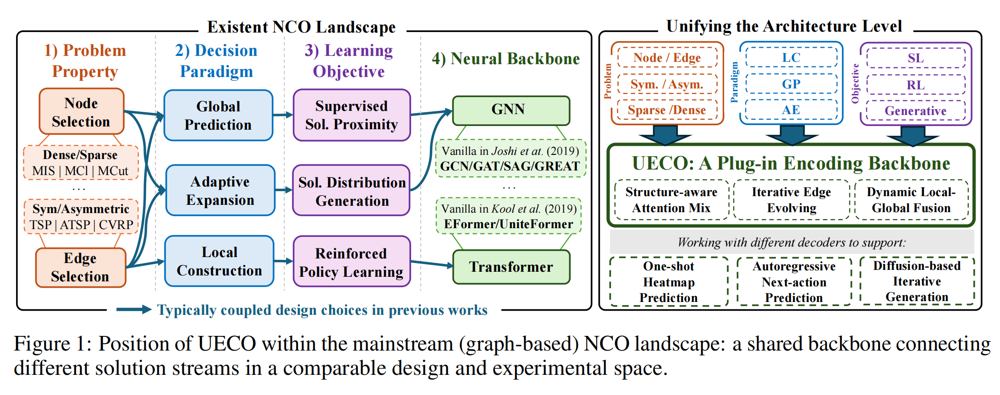
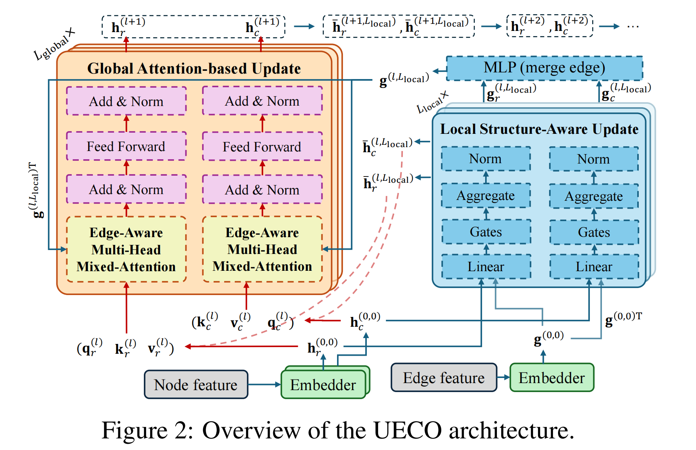

# UECO: A Unified Encoder for Neural Combinatorial Optimization with Iterative Edge-Node Reasoning

This is the official implementation of our ****NeurIPS 2026 Oral**** paper "[UECO: A Unified Encoder for Neural Combinatorial Optimization with Iterative Edge-Node Reasoning](https://openreview.net/forum?id=M2lqt23VO7)".

## Abstract

Despite the promise of Neural Combinatorial Optimization (NCO), recent literature has increasingly coupled decision paradigms, training objectives, and problem classes with specific backbone architectures, limiting generic model design and fair cross-paradigm evaluation. We propose UECO, a simple yet effective Unified Encoder for Combinatorial Optimization with a structure-aware attention mixture scheme, where a lightweight module defined upon graph-based locality is interleaved with conventional global node-focused attention blocks to dynamically evolve edge representations and inject local topological information into attention scores. Instead of fusing static edge features in a single step, UECO integrates local and global messages in a progressive and problem-agnostic manner. UECO works with Local Construction (LC), Global Prediction (GP), and Adaptive Expansion (AE) paradigms, across node- or edge-oriented problems, symmetric or asymmetric tasks, sparse or dense graphs, and supervised, reinforcement, or generative learning. Experiments show that replacing existing encoders with UECO improves solution quality and generalization across TSP, ATSP, CVRP, ACVRP, MIS, MaxClique, and MaxCut at multiple scales.

## 🌐 Why a Unified Encoder?

Neural combinatorial optimization has developed along several successful but largely separated streams. Local Construction (LC), Global Prediction (GP), and Adaptive Expansion (AE) methods are commonly paired with different learning objectives, task families, and neural backbones. This empirical coupling makes architectural choices a confounding factor: moving to a new solving paradigm often requires redesigning the representation model as well, obscuring controlled comparison and limiting transfer across problems.

UECO decouples **representation learning** from **decision making**. It provides a **shared, plug-and-play encoder** that preserves the long-range relational modeling of attention while explicitly capturing the local topology carried by graph edges. The same backbone can therefore serve **autoregressive policies**, **one-shot heatmap predictors**, and **iterative generative solvers** across *node- and edge-oriented*, *dense and sparse*, *symmetric and asymmetric* CO problems.



## 🧩 Iterative Edge-Node Reasoning

UECO jointly maintains node and edge representations through two complementary components. A **global node-centric attention module** captures long-range dependencies, while a lightweight **local structure-aware module** aggregates neighborhood information and evolves edge states. Rather than injecting fixed edge features once, UECO interleaves these components layer by layer: **locally refined edge embeddings dynamically modulate the next global attention scores, and the updated node semantics in turn guide subsequent edge evolution**.

Modality-specific embedders support node features, edge features, or both. For directional and asymmetric instances, dual node channels retain the two endpoint views of each edge before their structural messages are merged. The final representations remain decoder-agnostic and can be consumed by global heatmap prediction, autoregressive next-action selection, or iterative solution generation.

<p align="center">
  
</p>


## ⚙️ Installation

```bash
conda create --name ml4co python=3.8
conda activate ml4co

pip install torch==2.1.0
pip install scipy==1.10.1
pip install --no-index torch-scatter -f https://pytorch-geometric.com/whl/torch-2.1.0+cu121.html
pip install --no-index torch-sparse -f https://pytorch-geometric.com/whl/torch-2.1.0+cu121.html
pip install --no-index torch-spline-conv -f https://pytorch-geometric.com/whl/torch-2.1.0+cu121.html
pip install --no-index torch-cluster -f https://pytorch-geometric.com/whl/torch-2.1.0+cu121.html

pip install ml4co-kit==0.3.3
pip install wandb==0.16.3
pip install tensordict==0.2.0
pip install pytorch-lightning==2.1.0
pip install einops==0.8.0
pip install matplotlib tqdm scikit-learn
```

## 📦 Data and weights

- Pretrained weights: [download](https://drive.google.com/file/d/1j3iD6Yv0pG97RsOgnU-jdiFhPKaNipUW/view?usp=sharing)
- Test data: [download](https://drive.google.com/file/d/1tLQBUBAMJLIcW3KtS5gSXzuuKmdG9VOD/view?usp=share_link)
- Training data: [ML4CO-Bench-101-SL](https://huggingface.co/datasets/ML4CO/ML4CO-Bench-101-SL/tree/main/train_dataset)

The repository layout is:

```text
weights/{AE,GP,LC}/<task>/*.pt
data/test/<TASK>/*.txt
data/train/<TASK>/<dataset-folder>/*.txt
```

Download the complete data and unzip them for full runs.

## 🧪 Evaluation

Run each entry from its task directory. Paths to test data and weights are written directly in each script as paths relative to that directory. The commands below are independent; run the desired command after entering its paradigm directory.

### Adaptive Expansion (AE)

```bash
cd AE

(cd tsp  && python test_tsp.py)
(cd mis  && python test_mis.py)
(cd mcl  && python test_mcl.py)
(cd mcut && python test_mcut.py)
```

### Global Prediction (GP)

```bash
cd GP

(cd tsp  && python test_tsp.py)
(cd mis  && python test_mis.py)
(cd mcl  && python test_mcl.py)
(cd mcut && python test_mcut.py)
```

### Local Construction (LC)

```bash
cd LC

(cd tsp  && python test_tsp.py)
(cd atsp && python test_atsp.py)
(cd cvrp && python test_cvrp.py)
(cd cvrp && python test_cvrplib.py)
```

Change `TEST_DATA`, `NODES_NUM`, or the corresponding configuration block in a task script to select another released setting.

## 🏋️ Training

Training is task-local and uses the same manual entry-point style. As above, each command is independent.

### Adaptive Expansion (AE)

```bash
cd AE

(cd tsp  && python train_tsp.py)
(cd mis  && python train_mis.py)
(cd mcl  && python train_mcl.py)
(cd mcut && python train_mcut.py)
```

### Global Prediction (GP)

```bash
cd GP

(cd tsp  && python train_tsp.py)
(cd mis  && python train_mis.py)
(cd mcl  && python train_mcl.py)
(cd mcut && python train_mcut.py)
```

### Local Construction (LC)

```bash
cd LC

(cd tsp  && python train_tsp.py)
(cd atsp && python train_atsp.py)
(cd cvrp && python train_cvrp.py)
```

Edit the configuration block in the script to select the dataset, GPU, batch size, and number of epochs.
